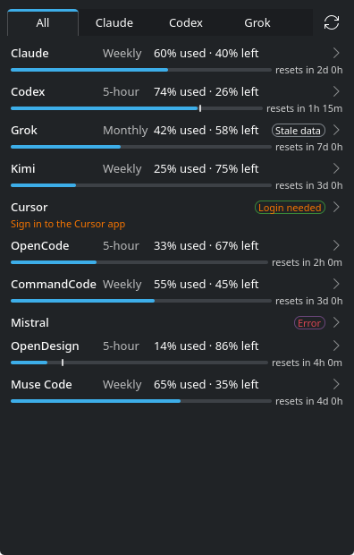
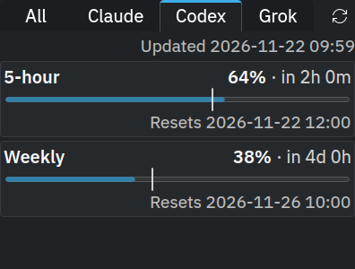

# Kuota

**AI account usage in your KDE Plasma panel.**

Kuota shows the usage windows, reset times, and account limits reported by
**Claude, Codex, Grok, Kimi, Cursor, OpenCode Go, CommandCode, Mistral,
OpenDesign, and Muse Code**. Use it as a compact panel summary or open the
overview and provider details on the panel or desktop.

It needs no Pi installation, permanent service, or runtime npm dependencies.
Usage comes from providers, not estimates based on local activity.



[Quick install](#quick-install) · [Providers and credentials](#providers-and-credentials) ·
[Troubleshooting](#troubleshooting) · [Development](#development) ·
[Changelog](CHANGELOG.md)

## Quick install

Needs KDE Plasma 6 and Node.js ≥20 at `/usr/bin/node` (full list under
[Requirements](#requirements)). Download the `.plasmoid` from the
[latest release](https://github.com/DarkoKuzmanovic/kuota/releases/latest), then:

```bash
kpackagetool6 -t Plasma/Applet -i kuota-v2.1.1.plasmoid   # first install
kpackagetool6 -t Plasma/Applet -u kuota-v2.1.1.plasmoid   # upgrade
```

Add **Kuota** from Plasma's **Add Widgets** dialog, then sign in to the
providers you use ([below](#providers-and-credentials)). After an upgrade,
restart Plasma (`systemctl --user restart plasma-plasmashell`) to load the new
code. To build from source instead, see [Installation](#installation).

## What it does

- **Panel summary:** provider icons, labels, usage values, and configurable
  caution/critical colors. “Icons only” hides the label, **not** the usage value.
- **All overview:** enabled providers in your chosen order, showing the tightest
  reported percentage window (or a count when no percentage is available), its
  reset, and current state. Select a row for that provider's details.
- **Detail view:** usage cards, reset countdowns, last-successful update time,
  and provider-specific facts. A pace tick marks elapsed time only when the
  provider reports both a reset and window duration: Codex and OpenDesign
  windows, Muse's current window, and Kimi's short window can supply these.
- **Appearance settings:** provider visibility/order, font family/scale,
  separators, spacing, custom icons, accents, text color, and opacity.
- **Independent refresh:** a short-lived Node collector fetches providers
  concurrently. Automatic refresh defaults to five minutes; the settings
  sanitizer enforces a five-minute minimum. Manual refresh is also available.
- **Failure handling:** last-known-good usage survives transient failures and
  is marked stale. Claude honors rate-limit backoff; Codex supports a bounded
  OAuth refresh and a curl fallback.
- **Offline diagnostics:** `kuota doctor` checks local credentials, caches,
  and runtime requirements without contacting providers.

Missing fields stay missing. An unlimited plan does not get an invented
percentage; a provider without monthly usage does not get a fabricated monthly
bar.




## Project status

Current release: **2.1.1** (2026-11-22), with the installable `.plasmoid` on
[GitHub Releases](https://github.com/DarkoKuzmanovic/kuota/releases). The
[changelog](CHANGELOG.md) tracks the full history back to 1.0.0. Kuota is not
on the KDE Store yet. See the [roadmap](ROADMAP.md) for candidate work, not
promises.

## Requirements

| Requirement | Notes |
|---|---|
| Linux with KDE Plasma 6 | Package declares Plasma API minimum 6.0; not a GNOME, macOS, or Windows widget. |
| Node.js ≥20 | The Plasma bridge invokes **`/usr/bin/node`**. A shell-only nvm/asdf installation is not sufficient. |
| npm and Git | npm is needed to build from source; Git is needed to clone it. TypeScript is a pinned development dependency. |
| `kpackagetool6` | Installs the package as `Plasma/Applet`. |
| `flock` from util-linux | Collector locking uses **`/usr/bin/flock`**. |
| `zip` | Needed to build the installable archive from source. |
| curl | Used when Codex's normal HTTP request needs the fallback transport. |
| `sqlite3` | Needed at **`/usr/bin/sqlite3`** to read the local Cursor session and the Firefox login for Mistral/OpenDesign/Muse Code; not needed when a usable environment fallback is used. |

For development, also install Qt 6's `qmllint`, Qt Quick Test, Kirigami, and the
Plasma QML modules. The current QML runner expects
`/usr/lib/qt6/bin/qmltestrunner`; distro paths may differ.

## Installation

From source (the release `.plasmoid` above skips these steps):

```bash
git clone https://github.com/DarkoKuzmanovic/kuota.git
cd kuota
npm ci --ignore-scripts
```

Install the checked-out source:

```bash
scripts/install.sh
```

Both install and update rebuild from source every time, even when the version
has not changed. They require a freshly produced, nonempty archive before
calling the package tool. To build without installing, run
`npm run build:artifact`.

The artifact checker runs the packaged collector offline in a private temporary
HOME with an allowlisted environment; it does not use your credentials. See the
[reliability amendment](docs/specs/2026-09-08-review-p1-fixes-design.md).

The build produces:

```text
dist/artifact/kuota-v2.1.1/           unpacked Plasma package
dist/artifact/kuota-v2.1.1.plasmoid  verified installable archive
```

The installer installs or upgrades the package for your user. Open Plasma's
**Add Widgets** dialog and add **Kuota** to a panel or the desktop. Click the
panel summary to open the detail view.

### Updating

1. Pull the desired source revision: `git pull --ff-only`.
2. Run `npm ci --ignore-scripts`.
3. Run `scripts/update.sh` (always rebuilds before upgrading).
4. Remove/re-add the widget or log out and back in to load the new code.

Build, check, and zip failures stop installation; previous same-version archives
are not reused. New configuration keys require reloading the widget instance.

### Uninstalling

```bash
scripts/uninstall.sh
```

This removes the package `io.github.darkokuzmanovic.kuota` and
`~/.cache/kuota/`. It does not delete Kuota's own logins
(`~/.config/kuota/credentials.json`; remove them with `kuota logout <provider>`
or delete the file) or edit Plasma's global configuration.

## Providers and credentials

Kuota keeps its own logins in `~/.config/kuota/credentials.json`
(`$XDG_CONFIG_HOME/kuota/`; file mode 0600, directory 0700). It does not read
Pi's `auth.json`. Sign in once per provider from a terminal with the bundled
collector; a short alias helps:

```bash
alias kuota='node ~/.local/share/plasma/plasmoids/io.github.darkokuzmanovic.kuota/contents/code/collector/cli.js'
kuota login codex        # ChatGPT: open the printed URL, enter the code
kuota login grok         # SuperGrok / X Premium, same flow
kuota login kimi         # Kimi Code (or: kuota login kimi --api-key)
kuota login opencode     # paste an API key (hidden), or pipe it on stdin
kuota login commandcode  # paste an API key
kuota status             # which source each provider uses (never values)
kuota doctor             # offline credential, cache, and runtime diagnostics
kuota logout codex
```

Claude, Cursor, Mistral, OpenDesign, and Muse Code need no `kuota login`: Kuota
reads the login you already have in Claude Code, Cursor, or Firefox.

Keys are never accepted as command arguments (they would show in `ps`). Never
put tokens in widget settings, issues, or screenshots. Kuota renews its own
Codex, Grok, and Kimi logins; it never refreshes or writes another tool's
login. Codex device sign-in must be allowed for your ChatGPT account.

| Provider | Data available when returned by the provider | Credential sources, in order |
|---|---|---|
| **Claude** | Session/weekly utilization, reset times, model-specific windows and extra-usage facts. | Claude Code's `~/.claude/.credentials.json` (`claudeAiOauth`, needs `user:profile` scope). Read-only, never refreshed; sign in with Claude Code. Uses a fresh Kuota-owned cache before a live fetch. |
| **Codex** | Primary/secondary usage windows, resets, plan/credit facts. | `kuota login codex`; then the Codex CLI's `~/.codex/auth.json` (`$CODEX_HOME`), read-only and never refreshed. |
| **Grok** | Monthly credits and an optional weekly window. | `kuota login grok`; `GROK_CLI_OAUTH_TOKEN` fallback. |
| **Kimi** | Weekly and short-window usage, resets, concurrency facts. | `kuota login kimi` (OAuth or `--api-key`); `KIMI_API_KEY` fallback. |
| **Cursor** | Included-plan spend share, billing reset, membership and on-demand usage facts. | Local Cursor `state.vscdb` session first, then `CURSOR_SESSION_TOKEN`. |
| **OpenCode Go** | Hosted Go plan: rolling 5-hour, weekly, and monthly percentages with resets. Not arbitrary OpenCode/Zen/API spend. | `kuota login opencode` (API key); `OPENCODE_API_KEY` fallback. |
| **CommandCode** | Five-hour and optional weekly windows; monthly/purchased/free credit facts and optional plan name. | `kuota login commandcode` (API key); `COMMANDCODE_API_KEY` fallback. |
| **Mistral** *(off by default)* | Vibe Code and API monthly budgets (percent, reset, spend in money); pay-as-you-go flag when returned. | Your Firefox login to admin.mistral.ai (session cookie, read-only); `MISTRAL_SESSION_COOKIE` fallback. |
| **OpenDesign** *(off by default)* | Coding-plan 5-hour and weekly credit windows; plan tier and wallet balance. | Your Firefox login to open-design.ai (session cookie, read-only); `OPENDESIGN_COOKIE` fallback. |
| **Muse Code** *(off by default)* | Current (typically 5-hour) and weekly subscription quota percentages and resets, plus plan tier when returned. | Your Firefox `dev.meta.ai` login (`llama_dev_sess`, read-only); `MUSE_SESSION_COOKIE` fallback. |

**Mistral, OpenDesign, and Muse Code read your browser login.** Kuota copies
Firefox's cookie store (newest profile) into a private temp directory, reads only
the site's session cookie, and deletes the copy. Cookies are used only for the
provider requests and never persisted by Kuota or refreshed. Enable these providers in
Settings → Providers; Firefox discovery requires system `sqlite3`. The fallback
environment variable contains the full Cookie header and is used when no
browser session is available; never paste it into an issue or screenshot.

Muse reads the teams and subscription-quota endpoints without minting API keys.
If multiple teams have ambiguous quotas, it reports an error; team IDs remain
private. Weighted quota amounts are used to calculate percentages.

**Provider limits matter:** CommandCode exposes monthly credit allowances, not a
monthly-used total; Kuota therefore has no monthly utilization window for it.
Cursor uses an unofficial dashboard endpoint. These are client/account-facing
surfaces, not a guarantee of a stable public API, and account plans can expose
different fields.

**Fallbacks are not overrides.** File/local credentials generally take
precedence. Unsafe files, malformed JSON, or malformed supported credential
entries can fail closed instead of using the environment fallback. A variable
exported in a terminal is not automatically inherited by the already-running
Plasma session; do not put secrets in a launcher command to work around that.

Kuota only ever writes its own `credentials.json` (refreshed Codex, Grok, and
Kimi logins, merged atomically with the file mode kept at 0600). Claude Code,
Codex CLI, Cursor, and Firefox logins are read-only.

## Configuration

Right-click Kuota and open its configuration dialog:

- **Providers:** display/collection selection, display order, and compact
  usage-window choices for every provider except Cursor (one window only).
- **Appearance:** display mode, font scale, separator, icon/label/value spacing,
  and countdown visibility.
- **Thresholds:** refresh interval and caution/critical utilization levels.
- **Theming:** optional fonts, icons, text colors, accents, and opacity. Native
  Plasma styling remains the default.

**“Show and collect usage”** controls both display and collection. Disabled providers are excluded
from future collector invocations, including credential discovery and requests.
Disabling all providers leaves the empty view and launches no collector; it does
not create a fresh observation. Re-enabling a provider requests a refresh.
Reordering providers or changing appearance does not trigger collection.

An in-flight collection may finish after a selection change, but its result is
discarded and only the latest selection is refreshed. Multiple widget instances
can select different providers without losing each other's cached records.

## Troubleshooting

Run `kuota doctor` first. It reports local classifications without sending
requests, refreshing credentials, or printing credential values. A successful
local credential check does not prove that the provider will accept it.
Firefox checks use the collector's private temporary cookie-database copy,
including its WAL, and remove it afterward. Unconfigured providers are
informational; doctor can exit nonzero for local safety or environment problems
or a non-OK cached observation. Caches retain successful observations, not the
latest failed refresh.

| Symptom | Check |
|---|---|
| Widget missing or old code still shown | Confirm installation used `-t Plasma/Applet`, rebuild the archive, then reload the widget or log out/in. |
| `auth-needed` | Check the correct credential source for that provider and sign in again. Do not paste the auth file into a bug report. |
| Mistral/OpenDesign/Muse `auth-needed` | Sign in to admin.mistral.ai, open-design.ai, or dev.meta.ai in Firefox (the most recently used profile), then refresh. Other browsers aren't read; use the cookie env fallback instead. |
| Cursor login appears stale | Confirm local Cursor login and `/usr/bin/sqlite3`. Kuota reads committed WAL updates; check DB/WAL/SHM access as described below. |
| `stale` | Last successful data is retained after a failed refresh. Check for endpoint changes or temporary failures; Claude may be in rate-limit backoff, which repeated Refresh clicks do not override. |
| `error` | A provider may be unreachable or have changed its response; also check fixed runtime paths and the trusted local cache directory. Other providers can still update. |
| Settings seem ignored | Reload after adding new config keys. Invalid values are sanitized to safe defaults; “Icons only” intentionally keeps the usage value. |
| Build has no `.plasmoid` file | Install `zip` and resolve any compiler/checker/zip failure, then rebuild. An unpacked directory alone is not a successful build. |
| Shell Node works but widget fails | Check `/usr/bin/node`; the bridge does not resolve your interactive shell's Node version manager. |

### Cursor local database access

Kuota opens `~/.config/Cursor/User/globalStorage/state.vscdb` (then the lowercase
`cursor` candidate) with SQLite's `-readonly` mode, without asserting that the
database is immutable. This includes committed updates in an open WAL. Kuota
does not copy, checkpoint, update, or persist the database or session token.

SQLite may need readable `-wal`/`-shm` sidecars and read-lock coordination.
Missing or unreadable local state can use `CURSOR_SESSION_TOKEN` as a fallback;
cancellation or resource limits stop discovery instead. Never attach databases,
sidecars, or tokens to bug reports.

## Development

The project uses strict TypeScript, Node's built-in test runner, and Qt Quick
Test. There are **no runtime npm dependencies**. Cursor's synthetic SQLite
integration tests additionally require `/usr/bin/sqlite3` and `/usr/bin/python3`
(Python 3 with its standard-library `sqlite3` module).

| Command | Purpose |
|---|---|
| `npm run typecheck` | Check TypeScript without emitting files. |
| `npm test` | Compile and run collector, filesystem, lifecycle, and secret-safety tests. |
| `npm run test:qml` | Run the offscreen Qt 6 UI/model/bridge suites. |
| `npm run validate:plasma` | Check package metainfo and lint QML/JS. |
| `npm run build:collector` | Build the runnable collector under `dist/collector/`. |
| `npm run build:artifact` | Build/package the widget and run the artifact checker. |

Run verification sequentially in a dedicated checkout with a disposable
`HOME` and an explicit minimal environment (not just a different HOME). The
artifact checker enforces its own isolation, but that is not a sandbox for
arbitrary test code or npm tooling.
Never run suites that share `dist/` concurrently. Remove generated `dist/`
between gates when investigating stale-output failures. The QML suite is
headless; it is not a substitute for a real panel/desktop smoke test.

The collector accepts no arguments (all providers) or one allowlisted
`--enabled-providers=<csv>` argument. **No credential arguments are accepted.**
For a no-provider serialization check inside an isolated verification home:

```bash
node dist/collector/cli.js --enabled-providers=
```

A normal successful invocation emits exactly one newline-terminated schema-v2
JSON document. Provider failures are records inside that document, not permission
to emit raw responses or secrets.

```text
plasmoid/           QML views, settings, and isolated collector bridge
collector/src/      Provider adapters, normalization, auth/cache I/O, redaction
collector/test/     Node collector tests
tests/              Synthetic fixtures, QML tests, security/lifecycle checks
scripts/            Build and local lifecycle commands
docs/               Architecture, approved specs, and review findings
dist/               Generated output; ignored by Git
```

Read [AGENTS.md](AGENTS.md) and [PLAN.md](PLAN.md) before contributing.
Product-visible changes require an approved design amendment. Add tests before
changing provider behavior or security-sensitive persistence, and use synthetic
fixtures rather than recorded credentials or raw account responses.

## Architecture and security

```text
Plasma views ↔ isolated CollectorBridge ↔ short-lived Node collector ↔ providers
                   normalized, validated JSON only
```

The collector owns all credentials and provider I/O. QML validates the complete
snapshot before replacing its current data. Cross-process locking protects
collection; cache writes use restrictive permissions; updates to Kuota's own
credentials file preserve unrelated entries and file mode. Redaction and module-isolation tests
protect these boundaries.

This is a local desktop integration, not a sandbox or an independent security
audit. Keep auth files private. Before sharing diagnostics, remove account
identifiers, tokens, environment values, and raw provider responses.

## Further reading

- [Architecture overview](docs/architecture/overview.md)
- [Collector JSON contract](docs/architecture/collector-contract.md)
- [Approved design and amendments](docs/specs/2026-07-10-kuota-design.md)
- [Changelog](CHANGELOG.md) · [Roadmap](ROADMAP.md)
- [Synthetic fixture policy](tests/fixtures/README.md)
- [GitHub issues](https://github.com/DarkoKuzmanovic/kuota/issues)

## License

[MIT](LICENSE). Not affiliated with or endorsed by the listed providers.
